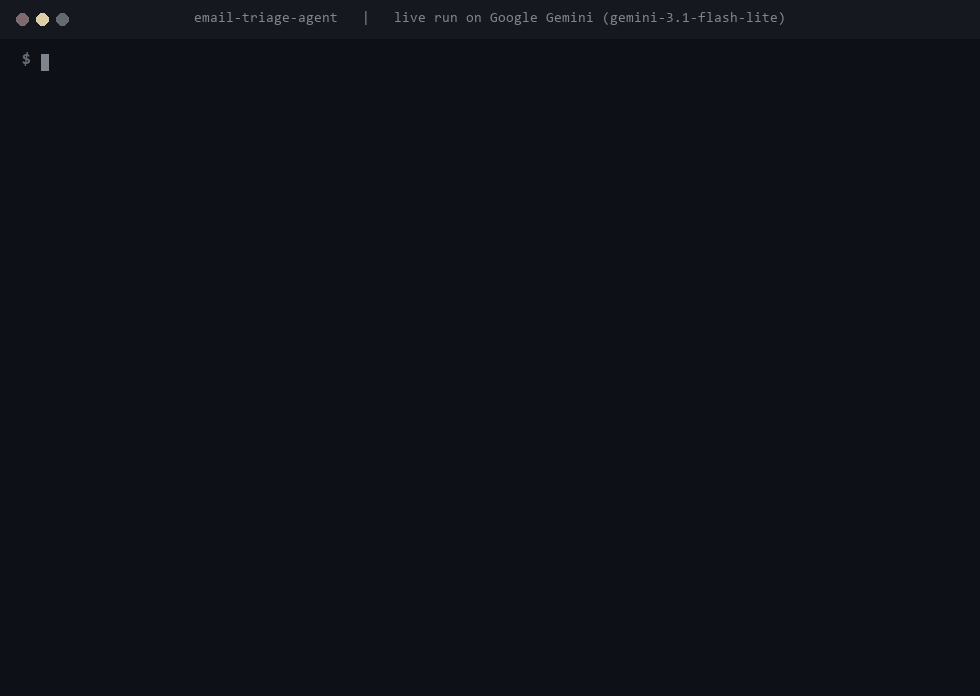

<h1>Email Triage Agent</h1>

<b>Sorts an inbox into routine, urgent, needs-a-human and spam, and gives each one a different level of autonomy. Nothing is sent without a person.</b>

  
  
  
  
  
  

  <a href="#what-it-does">What it does</a> &nbsp;|&nbsp;
  <a href="#how-it-works">How it works</a> &nbsp;|&nbsp;
  <a href="#sample-run">Sample run</a> &nbsp;|&nbsp;
  <a href="#quick-start">Quick start</a> &nbsp;|&nbsp;
  <a href="#configuration">Configuration</a> &nbsp;|&nbsp;
  <a href="#roadmap">Roadmap</a>

 

<h2>See it in action</h2>

Recorded from a real run on Google Gemini (<code>gemini-3.1-flash-lite</code>) on 12 November 2026. Nothing is edited or scripted. Only the waiting time while the model thinks is shortened. <a href="demo/demo.mp4">Download the MP4</a>.

<h2>The problem</h2>

A shared inbox mixes questions answered a hundred times before, messages that need a careful human reply, the occasional legal or angry email that needs attention today, and a lot of noise.

Treating all of these the same way is the mistake. An autoresponder that confidently answers a legal threat does more damage than having no automation at all.

<h2>What it does</h2>

<table>
  <tr><th align="left">Capability</th><th align="left">What that means in practice</th></tr>
  <tr><td><b>Routine</b></td><td>Common questions are matched to the FAQ and the agent drafts a complete reply from it, not from memory.</td></tr>
  <tr><td><b>Urgent</b></td><td>Legal threats, cancellations and angry customers get no draft at all. The agent flags them and sends a Slack alert so a person sees them right away.</td></tr>
  <tr><td><b>Needs a human</b></td><td>Partnership and sales conversations get a short, non-committal draft for a person to edit and send.</td></tr>
  <tr><td><b>Spam</b></td><td>Marked and archived.</td></tr>
  <tr><td><b>A reason for every decision</b></td><td>Each email is logged with its category and a one-line reason, so you can check the agent's judgement over time.</td></tr>
  <tr><td><b>Full audit log</b></td><td>Every email, decision and draft is written to <code>output/triage_log.csv</code>.</td></tr>
</table>

<h2>How it works</h2>

<pre>
email --&gt; classify --+--&gt; routine      --&gt; FAQ lookup --&gt; drafted reply
                     +--&gt; urgent       --&gt; flag + Slack alert, no reply
                     +--&gt; needs_human  --&gt; short draft for a person
                     +--&gt; spam         --&gt; archive
</pre>

A LangGraph pipeline classifies each email with structured output (category and reason), then routes it to the handler for that category. Drafts are returned and logged. The function is called <code>draft_reply</code> on purpose, so nobody reading a log thinks mail went out.

This version reads from <code>data/inbox.json</code>. The triage logic doesn't change when it is connected to a real Gmail or Outlook inbox. Only the reading and sending layer does.

<h2>Decisions I made on purpose</h2>

<h3>Autonomy is earned</h3>

Most businesses aren't ready to let software send mail under their name on day one, and they shouldn't be. What they are ready for is something that drafts well and flags correctly, so they can watch it for a few weeks. Auto-sending can come later, starting with the narrowest category.

<h3>Urgent mail gets no AI draft</h3>

Being wrong on a legal or angry email is expensive, and the agent shouldn't be the one deciding what to say. Its job there is to make sure a person sees it fast.

<h2>Sample run</h2>

<pre>
$ python process_inbox.py
[ROUTINE] What are your business hours? (from priya@customerco.com)
  Reason: Common question with a direct, standard answer available.
  Action: Answer found in FAQ. Drafted reply to priya@customerco.com

[URGENT] Cease and desist notice regarding trademark usage (from legal@somefirm.com)
  Reason: Legal threat requiring immediate human attention.
  Action: Flagged URGENT, needs a human today, no auto-reply sent.

[SPAM] You have WON a prize!!! Claim NOW (from winbig@totally-not-spam.biz)
  Reason: Promotional spam with urgency bait, not a real inquiry.
  Action: Marked as spam, archived, no reply needed.

Summary: {'routine': 2, 'urgent': 2, 'needs_human': 1, 'spam': 1}
</pre>

<h2>Quick start</h2>

You need Python 3.12 or newer and an API key from OpenAI, Anthropic or Google Gemini.

<pre>
pip install -r requirements.txt
cp .env.example .env        # on Windows: copy .env.example .env
# open .env and paste your API key
python process_inbox.py
</pre>

<h2>Configuration</h2>

Everything is set in <code>.env</code>. Copy <code>.env.example</code> to start.

<table>
  <tr><th align="left">Variable</th><th align="left">Required</th><th align="left">Purpose</th></tr>
  <tr><td><code>LLM_MODEL</code></td><td>Yes</td><td>Which model to use, as <code>provider:model</code>. Default <code>openai:gpt-5.5</code>. Also works with <code>anthropic:claude-opus-5-5</code> or <code>google_genai:gemini-3.5-flash</code>.</td></tr>
  <tr><td><code>OPENAI_API_KEY / ANTHROPIC_API_KEY / GOOGLE_API_KEY</code></td><td>One of them</td><td>The key for whichever provider you picked.</td></tr>
  <tr><td><code>SLACK_WEBHOOK_URL</code></td><td>No</td><td>Sends a Slack alert for every urgent email.</td></tr>
</table>

<h2>Project structure</h2>

<pre>
email-triage-agent/
  .env.example                                           # copy to .env and add your key
  case_study.md                                          # longer write-up of the design
  process_inbox.py                                       # triages the whole inbox and writes the log
  README.md
  requirements.txt                                       # dependencies
  .git/
    COMMIT_EDITMSG
    config
    description
    HEAD
    hooks/applypatch-msg.sample
    hooks/commit-msg.sample
    hooks/fsmonitor-watchman.sample
    hooks/post-update.sample
    hooks/pre-applypatch.sample
    hooks/pre-commit.sample
    hooks/pre-merge-commit.sample
    hooks/pre-push.sample
    hooks/pre-rebase.sample
    hooks/pre-receive.sample
    hooks/prepare-commit-msg.sample
    hooks/push-to-checkout.sample
    hooks/sendemail-validate.sample
    hooks/update.sample
    index
    info/exclude
    logs/HEAD
    logs/refs/heads/main
    logs/refs/remotes/origin/main
    objects/0d/19a37d674a332b9dba9f34ec54f3144a81a21f
    objects/2a/46591d6d09a5886c095972b3f931afb88353cb
    objects/34/a1aaf361b1a01235b510ee8101c12a9e9c0bf6
    objects/36/2336d2b8e655e7d6370a11541e836b4d1d0f37
    objects/40/51332f1897fe6e11f1f5873f02a861a381a96a
    objects/55/ec08e05c3fdf6e24797e0842566b0d1b2d8acf
    objects/6a/5a878cd51213838455fa0fd325eb8af6d033bb
    objects/78/998da0758f803a8b7d9b492206632524003f81
    objects/7a/3a4f0ab20b8170a7b714479283340f5fe09e10
    objects/81/5e21da7ab05f5b4c375f1b9a44f87fc7038019
    objects/82/e9d1be3967529d71326b4776074e05a5f857a5
    objects/8a/e3924659b56cb38b3fdf140fd15e3414504e7e
    objects/8e/2735a773baa4ce125dc92d2e99c36cb2807725
    objects/a2/667477f906e25e4d46862b73a0cf1d10163a78
    objects/b4/0c906a6641293e3dad454daf7b665b5a4d2c01
    objects/bb/1d0d20270c6b562a687dd6c5e21f3c4d7ba090
    objects/c4/0c1adf59a8996b3acd6db2116e6af35a09e938
    objects/c5/4aeb32cf364cf433dfb7c8ce58583bc231b3a2
    objects/c5/97c23fa30e7a1e2dfac8278bb520f879e325c9
    objects/d7/830614cbf458ef390333b9b3946a011ea03d3b
    objects/d9/ffe3cd2f0d4bd4ffa4f6686b80b1f95b570f4f
    objects/de/746f20e8d94bc4bca3a762ef31b38beac8dfce
    objects/de/878e51889545852ecc85a58bc263c0fbe8d372
    objects/e5/6d0464232e3f00c54b6317bcda0a87126ef783
    objects/e6/9de29bb2d1d6434b8b29ae775ad8c2e48c5391
    objects/fd/623b2a03c73a229749cd340ea80ef4281c2ff1
    refs/heads/main
    refs/remotes/origin/main
  agent/
    llm.py                                               # picks the model from LLM_MODEL
    tools.py                                             # FAQ lookup, draft and Slack alert
    triage.py                                            # the classify and route pipeline
  data/
    faq.json                                             # answers the routine bucket draws from
    inbox.json                                           # sample inbox
  demo/
    demo.gif
    demo.mp4
  tests/                                                 # pytest suite, runs without any API key
</pre>

<h2>Built with</h2>

Python &nbsp;&middot;&nbsp; LangGraph &nbsp;&middot;&nbsp; LangChain &nbsp;&middot;&nbsp; Pydantic &nbsp;&middot;&nbsp; Slack &nbsp;&middot;&nbsp; OpenAI / Anthropic / Gemini

<h2>Tests</h2>

<pre>
pip install -r requirements-dev.txt
pytest
</pre>

Four tests cover the FAQ matching, what each of the four buckets does, the optional Slack alert and the full pipeline with a stand-in model. None of the tests call a model or need an API key, so they run on GitHub Actions on every push. The badge at the top shows the latest result.

<h2>Roadmap</h2>

What I would build next if a client took this into production:

<ul>
  <li>Read and draft directly in Gmail or Outlook, with drafts saved in the mailbox for one-click sending</li>
  <li>A hard rules layer above the model: certain senders, refund requests and legal language always go to urgent</li>
  <li>Auto-send for the routine bucket only, once the classification has a proven track record</li>
</ul>

<h2>More from this series</h2>

Nine production-minded AI agents, each solving one business problem properly.

<table>
  <tr><td><a href="https://github.com/saqib-n/ai-research-report-agent"><b>Research Report Agent</b></a></td><td>Researches a topic, notices its own gaps, and writes a report with a source for every claim.</td></tr>
  <tr><td><a href="https://github.com/saqib-n/ai-sales-outreach-agent"><b>AI Sales Outreach Agent</b></a></td><td>Personalised cold emails and follow-ups, with a human approving every send.</td></tr>
  <tr><td><a href="https://github.com/saqib-n/ecommerce-automation-agent"><b>E-commerce Order and Inventory Agent</b></a></td><td>Shopify order, stock and returns assistant, plus a monitor that warns you before stock runs out.</td></tr>
  <tr><td><a href="https://github.com/saqib-n/lead-qualification-crm-agent"><b>Lead Qualification Agent</b></a></td><td>Scores inbound leads against your own rubric and pushes the good ones to HubSpot.</td></tr>
  <tr><td><a href="https://github.com/saqib-n/multi-agent-customer-support"><b>Multi-Agent Customer Support</b></a></td><td>A router plus specialist agents for orders, refunds, FAQs and human handoff.</td></tr>
  <tr><td><a href="https://github.com/saqib-n/rag-knowledge-base-agent"><b>RAG Knowledge Base Agent</b></a></td><td>Answers questions from your own documents and names the source for every answer.</td></tr>
  <tr><td><a href="https://github.com/saqib-n/recruiting-screening-agent"><b>Resume Screening Agent</b></a></td><td>Ranks resumes against a job description with evidence, and guards against common bias.</td></tr>
  <tr><td><a href="https://github.com/saqib-n/whatsapp-support-agent"><b>WhatsApp Support Agent</b></a></td><td>A WhatsApp Cloud API agent that checks orders, answers FAQs and escalates to a person.</td></tr>
</table>

<h2>Work with me</h2>

I'm Saqib Nawaz, founder of WolfXense AI. I build AI agents and automations for businesses, with Python, LangChain, LangGraph and n8n, and connect them to the tools teams already use, like CRMs, Shopify, Slack, email and WhatsApp.

If your team loses hours every day sorting a shared inbox, I can connect this to your mailbox and your own FAQ and set the rules for what gets flagged.

<a href="https://www.upwork.com/freelancers/~01de008504a38baf28"><b>Hire me on Upwork</b></a> &nbsp;|&nbsp; <a href="https://github.com/saqib-n"><b>More of my work on GitHub</b></a>

Released under the <a href="LICENSE">MIT License</a>. A longer write-up of the design is in <a href="case_study.md">case_study.md</a>.

